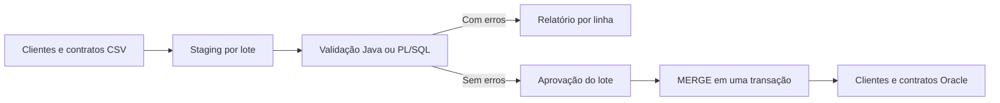

# MigraERP — Migração de Clientes e Contratos

Uma empresa troca de ERP e precisa importar clientes e contratos exportados pelo sistema antigo. A API recebe dois CSVs, guarda suas linhas em staging, registra inconsistências e carrega o destino Oracle após aprovação explícita. Os exemplos usam dados fictícios.

**Stack** · Java 21 · Spring Boot 3.5 · Oracle Database Free · JDBC · JUnit 5 · Docker Compose



## 1. Subir o projeto

Com Docker Desktop em modo Linux Containers, ou Docker Engine com Compose, abra esta pasta e rode:

```powershell
docker compose up -d --build --wait
docker compose ps
docker compose logs oracle
docker compose logs api
```

| Conexão | Valor padrão |
|---|---|
| API | `http://localhost:8080/api/lotes` |
| Host e porta Oracle | `localhost:1521` |
| Serviço da PDB | `FREEPDB1` |
| URL JDBC | `jdbc:oracle:thin:@//localhost:1521/FREEPDB1` |
| Usuário da aplicação | `migraerp` |
| Senha local de demonstração | `MigraerpLocal_2026` |

O volume persiste as tabelas entre reinicializações. No primeiro boot, a imagem cria o usuário na PDB e executa `db/install.sql`. O healthcheck espera o banco e a instalação do schema. As portas ficam vinculadas a `127.0.0.1`. A aprovação nesta API local é uma transição de estado, sem autenticação.

Defina `ORACLE_PASSWORD` e `MIGRAERP_DB_PASSWORD` em um arquivo `.env` antes da primeira inicialização se quiser trocar as senhas de demonstração. `ORACLE_PORT` e `API_PORT` ajustam as portas no host. Para rodar e depurar o Java na IDE com JDK 21 e Maven 3.9, suba apenas o serviço `oracle` e execute `mvn spring-boot:run`. A aplicação lê `SPRING_DATASOURCE_URL` e `SPRING_DATASOURCE_PASSWORD` se você alterar a conexão.

```powershell
docker compose up -d --wait oracle
docker compose exec -T oracle bash /migraerp-db/sql.sh '@/migraerp-db/dicionario.sql'
docker compose exec oracle bash /migraerp-db/sql.sh
```

## 2. Modelagem e particularidades do Oracle

| Tabela | Chave e propósito |
|---|---|
| `lote` | PK `id`; estado do fluxo, timestamps e resultados da validação. |
| `staging_registro` | PK `(lote_id, entidade, linha)`; FK para lote; conserva textos para validar datas e valores depois do upload. O código pode se repetir para permitir diagnosticar todas as ocorrências. |
| `erro_validacao` | FK para a linha de staging e PK que acrescenta campo e código do erro. Uma linha pode ter diversos erros. |
| `cliente` | PK técnica `id` e chave de negócio única `codigo`. |
| `contrato` | PK técnica `id`, chave de negócio única `codigo`, FK `cliente_id`, `CHECK` de período e valor. |
| `controle_migracao` | Uma linha travada durante a baixa no destino para serializar lotes que possam escrever as mesmas chaves. |

| No Oracle | Decisão no projeto |
|---|---|
| `NUMBER(18)` e `GENERATED ALWAYS AS IDENTITY` | IDs inteiros gerados pelo banco. No JDBC, peça a coluna `ID` em `prepareStatement` para recuperar sua chave gerada pelo nome. |
| `NUMBER(12,2)` | Valor exato com 10 dígitos inteiros e 2 decimais. CSV usa ponto. O SQL fixa `NLS_NUMERIC_CHARACTERS` na conversão. Em Java, `BigDecimal` representa o valor na validação e nos testes. |
| `VARCHAR2(n CHAR)` | Comprimento declarado em caracteres. Oracle trata a string de comprimento zero como `NULL`. Staging mantém até 1.000 caracteres por campo, retira espaços externos e registra truncamento como erro. |
| `DATE` | No Oracle inclui hora, minuto e segundo. As datas do CSV chegam à meia-noite por conversão explícita com máscara `FXYYYY-MM-DD`. A janela aceita anos de 1900 a 9999. |
| `TIMESTAMP(6)` | Precisão de microssegundos para auditoria. O banco grava UTC com `SYS_EXTRACT_UTC(SYSTIMESTAMP)`. O JDBC lê o valor como UTC e a API o devolve em ISO 8601 com sufixo `Z`. |
| Dicionário de dados | `USER_TABLES` lista as tabelas do schema. `USER_TAB_COLUMNS` mostra tipos, e `USER_CONSTRAINTS` com `USER_CONS_COLUMNS` revela PKs (`P`), únicas (`U`), FKs (`R`) e condições (`C`). Oracle registra identificadores SQL sem aspas em maiúsculas. |

Conecte pelo **nome de serviço** `FREEPDB1`. O usuário `MIGRAERP` é dono do schema nessa PDB. No SQL Server, procure o equivalente das consultas ao dicionário em `sys.*`. No PostgreSQL, use `information_schema` ou `pg_catalog`. A FK `contrato.cliente_id` recebe um índice declarado no DDL. Confira a cobertura com `USER_IND_COLUMNS`.

## 3. Rodar a demonstração pela API

Os dois arquivos devem ser UTF-8, separados por vírgula, com cabeçalhos iguais aos exemplos. Cada arquivo aceita até 8 MB e 50 mil registros. Envie os dois cabeçalhos mesmo quando um arquivo não tiver registros. Campos entre aspas podem conter vírgulas e quebras de linha. O número no relatório é o da primeira **linha física** de cada registro. Arquivo com cabeçalho inválido, UTF-8 inválido ou aspas abertas retorna `400`. Registro com número incorreto de colunas vai para staging com um erro em `_linha`.

### Lote com inconsistências

```powershell
$base = 'http://localhost:8080/api/lotes'
$ruim = (curl.exe -sS --fail-with-body -F 'clientes=@examples/invalidos/clientes.csv' -F 'contratos=@examples/invalidos/contratos.csv' $base | ConvertFrom-Json).id

curl.exe -sS -X POST "$base/$ruim/validar?motor=JAVA"
curl.exe -sS "$base/$ruim/erros?offset=0&limit=100"
curl.exe -sS "$base/$ruim/conciliacao"
curl.exe -sS -i -X POST "$base/$ruim/aprovar"

curl.exe -sS -X POST "$base/$ruim/validar?motor=PLSQL"
curl.exe -sS "$base/$ruim/erros"
```

Em um banco novo, espere **2 linhas válidas e 9 inválidas**, com 12 ocorrências no relatório. A aprovação retorna `409`. O contrato que referencia `C-DUP` fica órfão porque as duas ocorrências desse cliente são inválidas. Um cliente já cadastrado no destino também pode satisfazer a referência. A checagem de duplicidade é por entidade e lote, usando o código do ERP de origem.

```json
{
  "entidade": "CLIENTE",
  "linha": 2,
  "campo": "codigo",
  "codigo": "DUPLICADO",
  "motivo": "Codigo repetido para esta entidade no lote"
}
```

O relatório de conciliação retorna uma linha por entidade. `importados` conta linhas do staging. `invalidos` conta linhas distintas com erro. `validos` e `invalidos` ficam nulos até a validação. `chavesNoDestino` conta linhas cujo código já está presente no destino no momento da consulta, inclusive quando a chave veio de um lote anterior. Use `GET /api/lotes/{id}` para verificar o estado e as datas da operação.

### Lote válido e atualização

```powershell
$bom = (curl.exe -sS --fail-with-body -F 'clientes=@examples/validos/clientes.csv' -F 'contratos=@examples/validos/contratos.csv' $base | ConvertFrom-Json).id
curl.exe -sS -X POST "$base/$bom/validar?motor=PLSQL"
curl.exe -sS -X POST "$base/$bom/aprovar"
curl.exe -sS -X POST "$base/$bom/migrar"
curl.exe -sS -X POST "$base/$bom/migrar"
curl.exe -sS "$base/$bom/conciliacao"

$atual = (curl.exe -sS --fail-with-body -F 'clientes=@examples/atualizacao/clientes.csv' -F 'contratos=@examples/atualizacao/contratos.csv' $base | ConvertFrom-Json).id
curl.exe -sS -X POST "$base/$atual/validar"
curl.exe -sS -X POST "$base/$atual/aprovar"
curl.exe -sS -X POST "$base/$atual/migrar"
```

No SQL*Plus, rode a consulta antes e depois do lote de atualização e compare os IDs e os valores.

```sql
select c.id cliente_id, t.id contrato_id, c.codigo, c.nome, t.codigo contrato, t.valor
from cliente c join contrato t on t.cliente_id = c.id
where c.codigo = 'C-101' and t.codigo = 'CT-101';
```

Os IDs permanecem e o valor muda de **1500,50** para **1750,75**. Em um lote novo, os `MERGE` usam o código de negócio no `ON` para decidir entre `UPDATE` e `INSERT`. O cliente vem primeiro para resolver a FK do contrato. Repetir a migração de um ID já migrado retorna o resultado anterior, inclusive se um lote posterior atualizou as mesmas chaves.

## 4. Transações e concorrência

`Jdbc.transaction` usa uma conexão com `autoCommit=false`. O mesmo `COMMIT` confirma os dois `MERGE` e a mudança para `MIGRADO`. Um erro na conversão do contrato faz `ROLLBACK` da escrita anterior de clientes e preserva o estado `APROVADO`, permitindo nova tentativa. Os SQLs de merge estão em `src/main/resources/sql`; o teste `falhaNoMergeContratoReverteClientePermiteNovaTentativa` provoca o erro alterando um valor no staging diretamente via JDBC, após a aprovação.

Para observar manualmente o bloqueio, crie um **novo lote aprovado**. Em um terminal SQL*Plus, substitua `123` pelo ID e mantenha a transação aberta.

```sql
select id from lote where id = 123 for update nowait;
```

Em outro terminal, chame `POST /api/lotes/123/migrar`. A API devolve `409` ao receber `ORA-00054`. Rode `ROLLBACK;` no primeiro terminal e tente novamente. A migração retorna `200`. Se o segundo pedido chegar após o commit do primeiro, já observa `MIGRADO` e também retorna `200`. Um lock adicional na tabela `controle_migracao` cobre lotes diferentes com chaves sobrepostas. O custo dessa decisão é executar uma migração de cada vez.

## 5. PL/SQL e desempenho

| Motor | Onde roda e o que trafega |
|---|---|
| `JAVA` | JDBC lê o staging com `LEFT JOIN` para identificar clientes já no destino. Java usa `HashMap` para duplicidades, `HashSet` para referências, `LocalDate` e `BigDecimal` para validar. Os erros são gravados em batches JDBC. |
| `PLSQL` | Um `CallableStatement` executa `VALIDAR_LOTE`, que grava os erros via `INSERT ... SELECT` e retorna as contagens em dois parâmetros `OUT`. A transação é confirmada pelo chamador. |

Abra `db/validation.sql` para acompanhar `COUNT(*) OVER (PARTITION BY lote_id, entidade, codigo)`. A função analítica identifica todas as ocorrências sem colapsar linhas como um `GROUP BY` faria. O `LEFT JOIN` identifica referências aos clientes no lote ou no destino. A conciliação agrupa os resultados por entidade e conta cada linha com erro uma vez.

Experimente chamar a procedure no SQL*Plus com o ID do lote inválido.

```sql
variable validos number
variable invalidos number
exec validar_lote(123, :validos, :invalidos)
print validos invalidos
rollback;
```

Rode o benchmark com a aplicação no ar. O parâmetro `-Api` permite ajustar a URL se a porta tiver mudado.

```powershell
powershell -NoProfile -ExecutionPolicy Bypass -File scripts/benchmark.ps1
```

O script gera **50 mil clientes e 50 mil contratos** em um lote sintético, alterna a ordem dos motores, verifica a contagem esperada (**99.350 válidas e 650 inválidas**) e grava `benchmark.log`. A rodada inicial aquece a JVM e o banco. `motorMs` mede a validação e a persistência de seus resultados, entre a obtenção do lock do lote e a consulta final do estado. A latência HTTP inclui a operação inteira. Compare medianas na mesma máquina.

O experimento do índice coleta estatísticas com `DBMS_STATS` e registra dois `EXPLAIN PLAN` da mesma consulta seletiva, antes e depois do índice `(lote_id, entidade, codigo)`. Registra também três execuções com o cronômetro do SQL*Plus em cada configuração. Compare `Operation`, `Rows`, `Cost` e `Predicate Information`. `EXPLAIN PLAN` mostra um plano estimado, e o tempo do SQL*Plus depende também do cache e da sessão. Um `INDEX RANGE SCAN` é uma hipótese para a busca seletiva. Confira o plano no log e considere o custo do índice para inserções em staging. O índice experimental é removido ao final do script, e o lote gerado fica disponível para inspeção.

| Resultado do experimento | Onde conferir |
|---|---|
| Medianas Java e PL/SQL | Linhas `mediana_motor_ms` em `benchmark.log`. |
| Plano sem índice e plano com índice | Blocos `ANTES` e `DEPOIS`, incluindo custo, cardinalidade e predicados. |
| Tempos da busca seletiva | Três execuções em cada bloco do log. Registre a mediana e as condições do ambiente. |

Estado desta entrega. O Docker Desktop não abriu o engine no ambiente de elaboração. Testes Oracle, planos e tempos precisam ser gerados com os comandos acima.

## 6. Testes

```powershell
# Todos os testes via Docker, com o Oracle do Compose
docker compose --profile test run --rm tests

# Com Java 21 e Maven instalados no host
mvn test
docker compose up -d --wait oracle
mvn -Poracle-it verify
```

Os testes unitários cobrem parsing de CSV, campos ausentes, UTF-8 inválido e contagem de erros. A integração verifica o fluxo HTTP com MockMvc e usa Oracle de verdade para staging, divergências entre motores, chaves únicas, migração válida, atualização, órfãos, rollback, reprocessamento e concorrência. As chaves dos testes usam sufixos aleatórios para permitir execuções repetidas no banco local.

Para reproduzir só a falha de migração e o retry, selecione o método de integração:

```powershell
docker compose --profile test run --rm tests mvn -B -Poracle-it '-Dit.test=MigracaoOracleIT#falhaNoMergeContratoReverteClientePermiteNovaTentativa' verify
```

## Decisões para explicar na entrevista

- **Por que validar antes do `MERGE`?** Oracle exige uma fonte estável para cada chave. A janela analítica identifica os duplicados no staging, e o bloqueio da aprovação mantém essas linhas fora do destino.
- **O que protege o reprocessamento?** `UNIQUE` e o `ON` pela chave do ERP de origem protegem o destino. O estado `MIGRADO` evita repetir efeitos de um lote antigo quando seu pedido HTTP é reenviado.
- **O que muda vindo de PostgreSQL ou SQL Server?** No Oracle, cheque o serviço da PDB, use as visões `USER_*` e explicite as conversões de número e data. Observe string vazia como `NULL` e a parte de hora no tipo `DATE`.
- **Por que testar Java e PL/SQL?** Java facilita depurar regras e escrever testes unitários. A validação set-based mantém o volume no Oracle e devolve contagens por parâmetros `OUT`. O teste de paridade reduz o risco de as duas implementações divergirem.
- **Como melhorar o plano?** Comece pela seletividade e pelos predicados, colete estatísticas e confirme o caminho escolhido pelo otimizador. Compare o benefício das buscas com a manutenção do índice na importação.

## Referências

- [Oracle Database SQL Language Reference — MERGE](https://docs.oracle.com/en/database/oracle/oracle-database/26/sqlrf/MERGE.html)
- [Oracle Database PL/SQL Language Reference — Transações e locks](https://docs.oracle.com/en/database/oracle/oracle-database/23/lnpls/transaction-processing-and-control.html)
- [Spring Boot 3.5 — Requisitos de sistema](https://docs.spring.io/spring-boot/3.5/system-requirements.html)
- [Imagem de contêiner para Oracle Database Free](https://github.com/gvenzl/oci-oracle-free)
